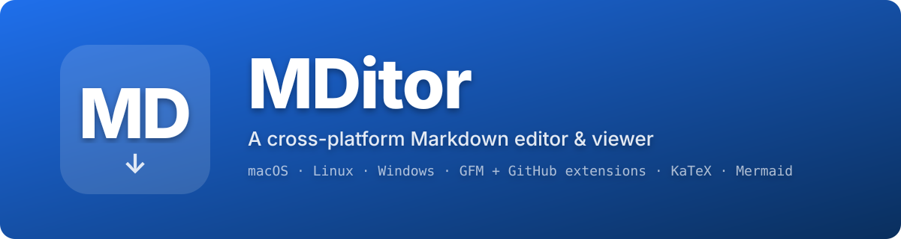

<p align="center">
  
</p>

# MDitor

<p>
  
  
  
  
  
</p>

A cross-platform desktop **markdown viewer & editor** with a side-by-side or tabbed live preview, an optional table-of-contents (TOC) panel, OS-native spell checking, Word-like formatting shortcuts, GitHub Flavored Markdown, and code syntax highlighting.

Runs on **macOS (Apple Silicon)**, **Windows (x64)**, and **Linux (x64)**.

## Features

- **Two views, one shortcut.** Edit and preview side-by-side or as switchable tabs (`Cmd/Ctrl+\`). Drag the divider to resize the split. In Split view the two panes scroll together; switch that off with the link button in either pane header, View → Sync Scrolling, or Settings.
- **TOC panel.** Left-side table-of-contents built from `#` (ATX) and Setext headings — click to jump in both editor and preview (`Cmd/Ctrl+Shift+T`). Shown by default.
- **Files panel & recent files.** File → Open Folder… (`Cmd/Ctrl+Shift+O`) shows a folder's Markdown files as a tree in the left sidebar; click one (or use the arrow keys and Enter) to open it in the same window. The tree keeps up as files are added, renamed, or removed. Toggle it with the toolbar's **Files** button or `Cmd/Ctrl+Shift+F`. File → Open Recent lists your last 15 files (also in the macOS Dock menu and the Windows jump list).
- **Native spell-check.** Uses your OS's dictionary via Electron's built-in spell checker (macOS, Windows, and Linux). Right-click misspelled words for suggestions and to add to your personal dictionary.
- **Word-like shortcuts.** `Cmd/Ctrl+B` wraps in `**bold**`, `Cmd/Ctrl+I` wraps in `_italic_`, `Cmd/Ctrl+U` wraps in `<ins>underline</ins>`. With no selection, the markers are inserted with the cursor placed between them. The exact markers are configurable in Settings.
- **Smart lists.** Press Enter on a `-`, `*`, `+`, or `1.` line to continue the list. Double-Enter exits the list.
- **Table helpers.** Inside a table, Tab / Shift+Tab jump to the next / previous cell (Tab in the last cell adds a row) and Enter starts a new row (Enter on an empty last row leaves the table). Format → Format Table (`Cmd+Option+T` / `Ctrl+Alt+T`) pads the columns so the pipes line up, keeping `:---:` alignment; Format → Insert Table adds an empty table.
- **Clickable task lists.** Check or uncheck a `- [ ]` item right in the preview; the `[ ]`/`[x]` in the source updates to match (and can be undone).
- **Smart links.** Typing `](` suggests the document's headings as `#anchors` and, once the document is saved, the files and images next to it (`Ctrl+Space` brings the list back). `Cmd`-click a link in the editor (`Ctrl`-click on Windows/Linux) to follow it. In the preview, `#heading` links scroll, links to other Markdown files open them in the window, web and mail links open in your browser or mail app, and other files open in their default app (folders and programs are only shown in Finder/Explorer).
- **Paste & drop images.** Paste a screenshot or drop image files into the editor: they're saved into the document's images folder (Settings → Files, `assets` by default; leave it empty to save next to the document) and linked where you pasted them. Existing files are never overwritten, and files already inside the document's folder are linked where they are. Save a new document first so its images have a folder to go to. Dropping a Markdown file on the window opens it.
- **Markdown lint.** The editor flags links to headings or files that don't exist (with a one-click fix when only the anchor's spelling is off, e.g. `#Intro` → `#intro`), empty links, undefined `[reference]` links, images without alt text, and skipped heading levels. The status bar shows the count; click it or press `Cmd/Ctrl+Shift+M` to list them, and `F8` to jump to the next one. Turn it off in Settings → Editor.
- **Vim keybindings.** Turn on in Settings → Editor. Normal, Insert, Visual, and Replace modes with operators, text objects, counts, registers, macros, marks, `/` search, and `:s`; `:w` saves, `:q` / `:q!` close the window, and `:wq` / `:x` save and close. On Windows and Linux the menu's `Ctrl` shortcuts take their keys first, so Vim commands such as `Ctrl+V` (visual block), `Ctrl+F` / `Ctrl+B` / `Ctrl+U` (scrolling), `Ctrl+O` (jump back), and `Ctrl+A` / `Ctrl+X` (increment / decrement) don't work there. `Ctrl+R` stays Vim's redo: View → Reload gives up that shortcut while Vim is on.
- **Find / Replace.** `Cmd/Ctrl+F` opens CodeMirror's search & replace panel.
- **Auto-save & crash recovery.** The toolbar's **Auto-save** switch (`Cmd/Ctrl+Shift+A`, or File → Auto-save) turns auto-save on or off for the current window. While it's on, a document with a file is saved about a second after you stop typing and when you switch to another window (an untitled one starts after its first save), and closing the window saves instead of asking. It pauses, and its tooltip says why, if the file was deleted, changed on disk while you had unsaved edits, or failed to save; saving resumes it. Settings → Files → **Auto-save on by default** sets the state each newly opened or created document starts in. Unsaved changes, untitled documents included, are also kept in a recovery copy: if MDitor quits unexpectedly, the next launch offers to restore them.
- **Picks up outside changes.** When the open file changes on disk (another editor, `git checkout`, a sync tool), MDitor reloads it in place and keeps your cursor and scroll position; `Cmd/Ctrl+Z` undoes the reload. If you have unsaved edits, a banner offers **Reload** or **Keep my version** instead; if the file is deleted or moved, it offers to **Save** it back. Files keep their line endings (LF or CRLF) when saved.
- **Export to PDF.** `Cmd/Ctrl+Shift+E` (or File → Export to PDF…) renders the current preview — math, Mermaid diagrams, syntax highlighting, and images included — to a PDF.
- **Export to HTML & Copy as Rich Text.** File → Export to HTML… (`Cmd/Ctrl+Shift+H`) saves the preview as one self-contained `.html` file, with images, math fonts, and diagrams embedded. Edit → Copy as Rich Text (`Cmd/Ctrl+Shift+C`) copies the preview — or just the part you selected in it — so it pastes with its formatting into Gmail, Google Docs, Slack, Notion, and similar apps (apps that only take plain text get the Markdown source).
- **Focus & typewriter modes.** Focus mode (`Cmd/Ctrl+Shift+Enter`) hides everything but the editor, sets the text in a centered column, and dims every paragraph except the one you're in. Leave it with the same keys, `Esc` (unless Vim keys are on), or the **Exit Focus** button that appears in the top-right corner. Typewriter mode (View menu or Settings → Editor) keeps the line you're typing vertically centered.
- **Status bar & zoom.** The status bar shows the cursor's line and column, word and character counts, and reading time (or the counts for the selection); the word count is an estimate that skips front matter, code blocks, link targets, and markup. View → Zoom In / Zoom Out / Actual Size (`Cmd/Ctrl+=` / `Cmd/Ctrl+-` / `Cmd/Ctrl+0`) scales the window from 50% to 300%. The level is remembered, and the status bar shows it when it isn't 100% (click it to reset). To resize only the preview's text, use the **A− / A+** buttons in the Preview header or View → Bigger / Smaller Preview Text (`Cmd/Ctrl+Alt+=` / `Cmd/Ctrl+Alt+-` / `Cmd/Ctrl+Alt+0`).
- **Settings.** `Cmd/Ctrl+,` opens a settings dialog: theme (auto/light/dark), formatting markers, editor options (scroll sync, typewriter mode, Markdown lint, Vim keybindings), files (auto-save on by default, images folder), default view (split/tabs), GitHub extensions on by default, and welcome-on-launch.
- **Light & dark themes.** Auto-follows the OS appearance by default; editor, preview, Mermaid, and code highlighting all switch together.
- **Always on:** GFM (tables, task lists, strikethrough `~~double~~`, autolinks), inline & display math (`$x^2$` / `$$ … $$`, via KaTeX), and Mermaid diagrams in ` ```mermaid ` fenced blocks.
- **YAML front matter.** A `---` block at the very top of a file is highlighted as YAML in the editor, kept out of the TOC, word count, and lint, and shown in the preview as a collapsible key/value table. The PDF and HTML exports leave it out.
- **GH toggle for GitHub-only extensions** (`Cmd/Ctrl+Shift+G`, on by default): alerts (`> [!NOTE]`/`[!TIP]`/`[!IMPORTANT]`/`[!WARNING]`/`[!CAUTION]`), footnotes (`[^1]`), single-tilde strikethrough (`~text~`), and emoji shortcodes (`:rocket:`).
- **Syntax-highlighted code blocks.** Powered by [highlight.js](https://highlightjs.org/) with the GitHub theme.
- **Local images & assets.** Relative image/asset paths in a document are served through a custom `mditor://` protocol so they render in the preview. HTML is sanitized with DOMPurify.
- **`.md` file association.** MDitor registers as a recommended app for `.md` files on all three OSes. Open/Save dialogs also accept `.markdown`, `.mdown`, and `.mkd`. Files must be UTF-8 text; others are refused rather than opened garbled.
- **Multi-window, single instance.** A single process owns all windows; opening a `.md` from the OS opens it in a new window (or brings forward the window that already has it), while launching MDitor again with no file focuses the existing window.

## Install

Pre-built binaries are attached to each [GitHub Release](../../releases). Pick the right one for your OS:

| OS | Architecture | File |
|----|--------------|------|
| macOS | Apple Silicon | `MDitor-<version>-arm64.dmg` |
| Windows | x64 | `MDitor Setup <version>.exe` |
| Linux | x64 | `MDitor-<version>.AppImage` (portable), `mditor_<version>_amd64.deb`, `mditor-<version>.x86_64.rpm` |

### macOS — first launch

The macOS DMG ships **unsigned** in the current release line. Gatekeeper will refuse to open it on the first launch. To bypass:

```sh
xattr -cr /Applications/MDitor.app
```

(Or right-click the app in Finder → Open → Open.)

### Linux

- **AppImage:** `chmod +x MDitor-<version>.AppImage && ./MDitor-<version>.AppImage`
- **deb:** `sudo apt install ./mditor_<version>_amd64.deb`
- **rpm:** `sudo dnf install ./mditor-<version>.x86_64.rpm`

### Windows

Run the NSIS installer (`MDitor Setup <version>.exe`). The installer registers the app for `.md` files and creates Start Menu and desktop shortcuts.

## Default file handler

After install, right-click any `.md` file → **Open With** → MDitor. Set as default to make double-clicking `.md` files launch MDitor.

## Keyboard shortcuts

| Action | Shortcut |
|--------|----------|
| New | `Cmd/Ctrl+N` |
| Open | `Cmd/Ctrl+O` |
| Open Folder (Files panel) | `Cmd/Ctrl+Shift+O` |
| Save | `Cmd/Ctrl+S` |
| Save As | `Cmd/Ctrl+Shift+S` |
| Toggle Auto-save | `Cmd/Ctrl+Shift+A` |
| Export to PDF | `Cmd/Ctrl+Shift+E` |
| Export to HTML | `Cmd/Ctrl+Shift+H` |
| Settings | `Cmd/Ctrl+,` |
| Undo | `Cmd/Ctrl+Z` |
| Redo | `Cmd+Shift+Z` (macOS), `Ctrl+Y` (Windows), `Ctrl+Shift+Z` (Linux) |
| Copy as Rich Text | `Cmd/Ctrl+Shift+C` |
| Find / Replace | `Cmd/Ctrl+F` |
| Bold | `Cmd/Ctrl+B` |
| Italic | `Cmd/Ctrl+I` |
| Underline | `Cmd/Ctrl+U` |
| Strikethrough | `Cmd/Ctrl+Shift+X` |
| Format Table | `Cmd+Option+T` / `Ctrl+Alt+T` |
| Next / previous table cell | `Tab` / `Shift+Tab` (in a table) |
| New table row | `Enter` (in a table) |
| Follow the link under the pointer | `Cmd`-click / `Ctrl`-click (in the editor) |
| Suggest link targets | `Ctrl+Space` (inside a link's `(…)`) |
| List lint warnings / go to the next one | `Cmd/Ctrl+Shift+M` / `F8` |
| Toggle Split / Tabs | `Cmd/Ctrl+\` |
| Toggle TOC Panel | `Cmd/Ctrl+Shift+T` |
| Toggle Files Panel | `Cmd/Ctrl+Shift+F` |
| Toggle GitHub Extensions (GH) | `Cmd/Ctrl+Shift+G` |
| Toggle Focus Mode | `Cmd/Ctrl+Shift+Enter` (`Esc` also leaves it) |
| Zoom In / Zoom Out / Actual Size | `Cmd/Ctrl+=` / `Cmd/Ctrl+-` / `Cmd/Ctrl+0` |
| Bigger / Smaller / Normal Preview Text | `Cmd/Ctrl+Alt+=` / `Cmd/Ctrl+Alt+-` / `Cmd/Ctrl+Alt+0` |
| Reload window | `Cmd/Ctrl+R` (Windows/Linux: not while Vim keys are on) |
| Keyboard Shortcuts dialog | `?` outside the editor (or Help menu) |

## Development

Requires **Node.js 20+** and npm. On first checkout:

```sh
npm install
npm run dev       # starts Vite + Electron
```

Icon files are committed under `build/`. Only re-run `npm run icons` after changing the source SVGs in `assets/` (`.icns` is regenerated on macOS only).

`npm run dev` launches the Vite dev server on port 5173 (renderer HMR) and an Electron window pointed at it; the main and preload processes are compiled once with `tsc`/`esbuild` before Electron starts. The app opens a sample document so you can verify the editor, preview, ToC, and spell-check immediately.

### Available scripts

| Script | Purpose |
|--------|---------|
| `npm run dev` | Vite dev server (renderer HMR) + compiled main/preload + Electron |
| `npm run build` | Compile renderer, main, and preload to `dist-renderer/` and `dist-main/` |
| `npm run pack` | `npm run build` then `electron-builder --dir` (unpacked app, no installer) |
| `npm run dist` | `npm run build` then `electron-builder` for the host OS |
| `npm run dist:mac` | `npm run build` then `electron-builder --mac --arm64` |
| `npm run dist:win` | `npm run build` then `electron-builder --win --x64` |
| `npm run dist:linux` | `npm run build` then `electron-builder --linux --x64` |
| `npm run icons` | Regenerate app + file icons from `assets/icon.svg` and `assets/file-icon.svg` into `build/` (`.icns` generated on macOS only) |
| `npm run check-version` | `node scripts/check-version.mjs <version>` — used by CI |
| `npm run typecheck` | TypeScript no-emit check on main+preload and renderer |
| `npm run test:e2e` | End-to-end tests: drives the real app with Playwright (see below) |

The composite scripts above also expose their individual steps: `dev:renderer`, `dev:electron`, `build:renderer`, `build:main`, and `build:preload`.

### End-to-end tests

```sh
npm run test:e2e                      # all suites
npm run test:e2e -- files export      # only suites whose file name contains "files" or "export"
npm run test:e2e -- --test-name-pattern="auto-save"   # only matching tests
```

`npm run test:e2e` builds main + preload, starts the Vite dev server on port 5173 (or reuses the one `npm run dev` is already running), launches the real Electron app with Playwright for each test, and shuts Vite down at the end. No other setup is needed after `npm install`.

- `e2e/suites/*.test.mjs` — [`node:test`](https://nodejs.org/api/test.html) suites (currently a smoke test: launch, open a file, close). Add one file per feature area.
- `e2e/harness.mjs` — `launch()` / `withApp()`, `menu()` (sends a menu action), `getDoc()` / `setDoc()` / `select()`, `waitFor()` / `never()`, temp fixtures, and more. Each app gets its own temporary `--user-data-dir`, so tests never see your real settings, recent files or recovery copies, and can run side by side.
- `e2e/main-stub.cjs` — loaded into the main process before the app: replaces native dialogs, `shell.openExternal`/`openPath`, `clipboard.write` and the OS recent-documents list with scriptable fakes (tests never open a real dialog or touch your system), and can delay or fail file reads/writes to test races.

Tests drive the app through menu actions, the editor API and a few key presses; they never depend on the window having OS focus, so you can keep working while they run (windows will pop up). Set `E2E_CONCURRENCY=n` to change how many suites run at once, `E2E_SKIP_BUILD=1` to skip the build, and `E2E_KEEP=1` to keep the temp profiles. `shot(page, name)` saves a screenshot to `e2e/.output/` when debugging. The **E2E** GitHub Actions workflow runs the suite on macOS for every push to `main` and every pull request.

### Project layout

```
src/
  main/         # Electron main process (windows, menu, IPC, spellcheck, file watching, recent files, crash recovery, mditor:// protocol)
  preload/      # contextBridge surface exposed as window.api
  shared/       # IPC channel names + payload types
  renderer/     # React app (CodeMirror editor, marked preview, ToC, Files panel, dialogs, toolbar, status bar)
build/          # committed app/file icons + macOS entitlements (regenerate with `npm run icons`)
assets/         # source SVGs for the icons
scripts/        # check-version + icon generator
e2e/            # end-to-end tests (Playwright + node:test): harness, main-process stub, suites/
electron-builder.yml   # packaging / file-association config
vite.config.ts         # renderer dev server + build
.github/workflows/release.yml   # release builds
.github/workflows/e2e.yml       # end-to-end tests on macOS
```

The renderer is sandboxed with `contextIsolation: true` and `sandbox: true`. All file I/O goes through the preload bridge — the renderer never touches `fs` directly.

## Releasing

1. Bump the `"version"` field in `package.json` (e.g. `0.1.0` → `0.2.0`) and commit.
2. Push to `main`.
3. Open the GitHub Actions tab → **Release** workflow → **Run workflow**.
4. Enter the same version in the `version` input. The workflow:
   - Validates the input matches `package.json` (fails fast on mismatch).
   - Builds the macOS DMG, Windows NSIS installer, and Linux AppImage/deb/rpm in parallel.
   - Uploads each artifact to **JFrog Fly** under `mditor/<version>/<filename>`.
   - Creates a **draft** GitHub release with all artifacts attached, ready for review.

The draft release is intentionally not published automatically — review the artifacts, edit the notes, then publish from the GitHub UI when ready.

## License

[MIT](LICENSE)
