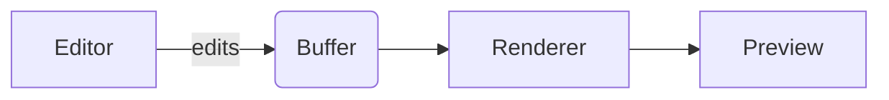

# Welcome to MDitor

A cross-platform **markdown** editor with a *live preview*. GFM, math, and mermaid are always on; toggle **GH Ext** for GitHub-only extensions.

## Always on

GFM, math (KaTeX), and mermaid render no matter what.

| Feature        | Example                          |
|----------------|----------------------------------|
| Tables         | this one                         |
| Task lists     | see below                        |
| Strikethrough  | ~~double tilde~~                 |
| Autolinks      | https://github.com               |

- [x] Tables, task lists, strikethrough, autolinks
- [ ] Inline math: $E = mc^2$

### Math (KaTeX)

$$
\int_{-\infty}^{\infty} e^{-x^2}\,dx = \sqrt{\pi}
$$

### Mermaid diagrams



## GH Ext — GitHub-only extensions (toggle to see them turn on/off)

> [!NOTE]
> Alerts render as colored callouts.
>
> With GH Ext off, this becomes raw `> [!NOTE]` text.

> [!TIP]
> You use [!NOTE], [!TIP], [!IMPORTANT], [!WARNING] and [!CAUTION]


Single-tilde strikethrough: ~one tilde~. Footnote ref: see [^1].

### Emoji shortcodes

`:rocket:` → :rocket:, `:tada:` → :tada:, `:coffee:` → :coffee:

## Code highlighting

```ts
function greet(name: string): string {
  return `hello, ${name}`;
}
```

## Handy extras

- **Auto-save:** flip the **Auto-save** switch in the toolbar (`Cmd/Ctrl+Shift+A`); Settings → Files turns it on for every file you open
- **Files panel:** **File → Open Folder…** (`Cmd/Ctrl+Shift+O`) lists a folder's Markdown files on the left
- **Focus mode:** `Cmd/Ctrl+Shift+Enter` hides everything but your text; `Esc` brings it all back
- **Status bar:** words, characters and reading time at the bottom; select some text to count just that
- **Copy as Rich Text:** `Cmd/Ctrl+Shift+C` copies the preview so it pastes formatted into Gmail, Docs or Slack
- **Images:** paste a screenshot or drop an image into a saved document; it lands in an `assets` folder next to it
- **Front matter:** start a file with a `---` YAML block; the preview shows it as a collapsible table

## Find your way around

- **Keyboard shortcuts:** **Help → Keyboard Shortcuts** (or click the **?** in the toolbar)
- **Find / Replace:** `Cmd/Ctrl+F` inside the editor (in the Preview tab, it searches the preview)
- **Reload the window:** `Cmd/Ctrl+R` (also under View → Reload)

[^1]: Footnotes appear at the bottom of the rendered output when `GH Ext` is on.
